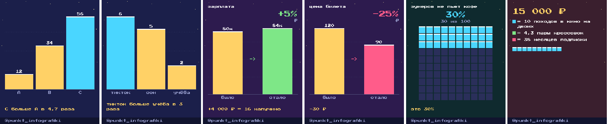

# PixelChart — пиксельный график в любом чате Telegram

Инлайн-бот: в любом диалоге пишешь `@бот 12, 34, 56` — и в чат вставляется пиксельная карточка-график с человеческим выводом («C больше A в 4,7 раза»). Без нейросетей, без платных API, рисует Pillow.



## Что понимает

| ввод | карточка |
|---|---|
| `12, 34, 56` | столбики |
| `кофе 3 чай 5 вода 8` | столбики с подписями |
| `зарплата 80к +5%` · `аренда 45к упала на 10%` | было / стало |
| `цена было 120 стало 90` | было / стало |
| `30 из 100 зумеров` · `37%` | доля (вафельный график) |
| `15000 рублей` · `3 часа` · `700 км` · `60 кг` | «сколько это в шаурме» |

Числа: `80к`, `1,5 млн`, `12 000`, `+5%`. Единицы и эквиваленты лежат в `data/equivalents.json` — правь свободно.

## Запуск за 10 минут

1. **BotFather**: `/newbot` → токен. Затем `/setinline` → выбери бота → подсказка вроде `числа: 12, 34, 56`. Опционально `/setinlinefeedback` не нужен.
2. **Канал**: добавь бота администратором в канал (нужно только право «читать», чтобы `getChatMember` работал).
3. **Код**:
   ```bash
   git clone https://github.com/Komarik230/pixelchart-bot && cd pixelchart-bot
   python3 -m venv .venv && source .venv/bin/activate
   pip install -r requirements.txt
   cp .env.example .env   # впиши BOT_TOKEN, CHANNEL_ID, OWNER_ID
   python bot.py
   ```
4. Напиши боту `/id`, впиши свой `user_id` в `OWNER_ID` в `.env`, перезапусти. В личку владельца бот будет присылать копии инлайн-карточек — так Telegram выдаёт `file_id`, без которого инлайн-режим не умеет отдавать картинки. Заодно видно, что люди рисуют.

## Как это работает

```
inline query ──► проверка подписки (getChatMember)
                  │ нет → кнопка «Подпишись на канал» (открывает ЛС бота, /start sub)
                  ▼ да
              parse(text) ──► Chart(kind, values, labels…)
                  ▼
              render_png()  ──► send_photo(OWNER_ID) → file_id → кэш cache.json
                  ▼
              InlineQueryResultCachedPhoto + кнопка «Сделать свой график»
```

- `pixelchart/parser.py` — разбор текста в спецификацию карточки
- `pixelchart/insights.py` — строка-вывод и подпись под фото
- `pixelchart/render.py` — отрисовка, палитра `PALETTE` и фоны `THEMES` в начале файла
- `data/equivalents.json` — единицы и «абсурдные эквиваленты»
- `make_examples.py` — перерисовать примеры в `examples/`

## Хостинг (бесплатно)

- **Свой ноутбук / Raspberry Pi** — `python bot.py`, polling, порты не нужны.
- **Oracle Cloud Always Free** — Ubuntu-виртуалка навсегда бесплатно. `deploy/pixelchart.service` — готовый systemd-юнит.
- **Любой VPS за 150–300 ₽/мес** — то же самое.
- **Docker**: `docker build -t pixelchart . && docker run --env-file .env -v $PWD/cache.json:/app/cache.json pixelchart`

## Переменные окружения

| имя | что |
|---|---|
| `BOT_TOKEN` | токен от BotFather |
| `CHANNEL_ID` | `@username` канала или `-100…` |
| `CHANNEL_URL` | ссылка для кнопки «Подписаться» |
| `CHANNEL_HANDLE` | подпись в подвале карточки |
| `OWNER_ID` | твой user_id (`/id`), туда уходят копии карточек |
| `CACHE_CHAT_ID` | куда слать копии, если не в ЛС владельца (например, приватный канал-склад) |
| `REQUIRE_SUB` | `1` — требовать подписку, `0` — пускать всех |

## Шрифт

Press Start 2P (SIL Open Font License) — `assets/fonts/`. Поддерживает кириллицу и `₽`.
